<!-- Animated Burgundy Hero Banner -->

  

<!-- Status & Identity Badges -->

  

<!-- ═══════════════════════════════════════════════════════════════════════════════ -->
<!-- EXECUTIVE SUMMARY                                                              -->
<!-- ═══════════════════════════════════════════════════════════════════════════════ -->

 

  

> **Senior Software & Systems Engineer (5+ Years Production Experience)** specializing in mission-critical Forward Deployed Engineering, cloud resilience (**AWS, Azure, Kubernetes, Terraform IaC**), zero-trust security governance (**HIPAA, PCI-DSS, Level 2 VAPT**), and enterprise agentic AI architectures (**LangGraph, Multi-Agent Swarms, Saga Compensating Transactions, Real-Time Observability**).

 

<!-- ═══════════════════════════════════════════════════════════════════════════════ -->
<!-- SECTION 01 · FLAGSHIP PRODUCTION ARCHITECTURES                                -->
<!-- ═══════════════════════════════════════════════════════════════════════════════ -->

  

 

  

  

 

  

 

<!-- ═══════════════════════════════════════════════════════════════════════════════ -->
<!-- SECTION 02 · TECHNICAL TOOLKIT & CORE COMPETENCIES                             -->
<!-- ═══════════════════════════════════════════════════════════════════════════════ -->

  

 

  

 

  

 

<!-- ═══════════════════════════════════════════════════════════════════════════════ -->
<!-- SECTION 03 · ENTERPRISE BENCHMARKS & TELEMETRY                                 -->
<!-- ═══════════════════════════════════════════════════════════════════════════════ -->

  

 

  

 

  

 

<!-- ═══════════════════════════════════════════════════════════════════════════════ -->
<!-- SECTION 04 · CASE STUDIES & COMMERCIAL BLUEPRINTS                              -->
<!-- ═══════════════════════════════════════════════════════════════════════════════ -->

  

 

  

 

  

 

<!-- ═══════════════════════════════════════════════════════════════════════════════ -->
<!-- SECTION 05 · CREDENTIALS & CERTIFICATIONS                                      -->
<!-- ═══════════════════════════════════════════════════════════════════════════════ -->

  

 

  

 

  

 

<!-- ═══════════════════════════════════════════════════════════════════════════════ -->
<!-- SECTION 06 · RESEARCH & ARCHITECTURAL WHITEPAPERS                              -->
<!-- ═══════════════════════════════════════════════════════════════════════════════ -->

  

 

  

 

  

 

<!-- ═══════════════════════════════════════════════════════════════════════════════ -->
<!-- SECTION 07 · GITHUB TELEMETRY & SYSTEM ACTIVITY                                -->
<!-- ═══════════════════════════════════════════════════════════════════════════════ -->

  

 

  

&nbsp;&nbsp;

  

 

  

 

<!-- ═══════════════════════════════════════════════════════════════════════════════ -->
<!-- SECTION 08 · EXECUTIVE CONTACT & VERIFIED PROFILES                            -->
<!-- ═══════════════════════════════════════════════════════════════════════════════ -->

  

  

  

  

📍 Mumbai, Maharashtra, India · Available for high-impact FDE engagements &amp; global remote roles

 

<!-- Minimal Animated SVG Footer -->

