<div align="center">

<!-- Animated Burgundy Hero Banner -->


<br/><br/>

<!-- Profile Avatar with Burgundy Identity -->
<a href="https://linkedin.com/in/ashrafksalim">
  
</a>

<br/><br/>

<!-- Status & Identity Badges -->
<a href="https://linkedin.com/in/ashrafksalim"></a>
<a href="mailto:ashrafksalim1@gmail.com"></a>
<a href="https://wa.me/919137785922"></a>
<a href="https://huggingface.co/spaces/ashrafksalim/contract-clause-risk-review"></a>
<a href="https://academy.langchain.com/certificates/1hhanf8ox7"></a>
<a href="https://academy.langchain.com/certificates/rlwlwmnqzc"></a>
<a href="https://www.credly.com/users/ashraf-khan.729bf623/badges/credly"></a>

<br/>


</div>

## 🧭 Executive Overview

Senior **Forward Deployed Engineer (FDE) & Multi-Cloud Solutions Architect** with **5+ years of production software engineering experience**, **10+ published commercial applications**, and **4 enterprise FDE system deployments**.

Specializes in bridging complex enterprise operational challenges with resilient multi-cloud architectures (**AWS Fargate, Azure Container Apps, Kubernetes HPA, Terraform IaC, TimescaleDB, PostgreSQL**), zero-trust security governance (**HIPAA, PCI-DSS, Level 2 VAPT, SEBI/RBI standards**), agentic AI workflows (**LangGraph, Tool Calling, Human-in-the-Loop Governance, Saga Compensating Transactions**), and high-throughput microservices.

### Verified Enterprise Impact

| Enterprise Financial Metric | Architecture / System | Production Outcome |
|:---|:---|:---|
| **₹4.5 Crore / Year** | Multi-Cloud Integration Platform | Integration and data reconciliation savings across 4 disparate feeds |
| **₹1.8 Crore / Year** | Healthcare AI Safety & Hybrid RAG | Administrative & clinical chart review reduction across 6 clinic locations |
| **₹25.20 Crore / Year** | Industrial Predictive Maintenance | Downtime & stamping line-halt prevention via real-time 50Hz telemetry |
| **87% MTTR Reduction** | Enterprise Operations AI Agent | Cloud incident MTTR slashed from 24.5 min to 3.2 min under strict HITL |
| **0.0% Diagnostic Leakage** | Clinical AI Intake Guardrails | Zero medical liability leakage verified across clinical benchmark evaluations |

<div align="center">

</div>

## 🎓 Education & Verified Certifications

### 🏛️ Formal Education
* 🎓 **B.Sc. in Computer Science** — **Mumbai University (Rizvi College)** *(2017 – 2020)*  
  **CGPA:** `9.33 / 10.00`
* 🏫 **Vocational Computer Science / HSC (12th)** — **M.H. Saboo Siddik Polytechnic, Mumbai** *(2015 – 2017)*  
  **Percentage:** `75.80%`

### 🏅 Verified AI, Cloud & Compliance Credentials
* 🤖 **LangChain**: [Project: Deep Research with LangGraph](https://academy.langchain.com/certificates/yn40p3bviz) *(Credential ID: `yn40p3bviz` · Oct 2026 – Oct 2028)* — Multi-agent research architecture, recursive search planning, iterative synthesis, and LangSmith evaluation.
* 🤖 **LangChain**: [Quickstart: LangGraph Essentials - Python](https://academy.langchain.com/certificates/1hhanf8ox7) *(Credential ID: `1hhanf8ox7` · Oct 2026 – Oct 2028)* — StateGraph orchestration, State schemas, Nodes, Edges, and Checkpointer memory.
* 🤖 **LangChain**: [Quickstart: LangSmith Essentials](https://academy.langchain.com/certificates/rlwlwmnqzc) *(Credential ID: `rlwlwmnqzc` · Issued Oct 2026)* — Developing, debugging, tracing, monitoring, and evaluating LLM and agentic workflows.
* ☁️ **Google Cloud**: [Introduction to Generative AI Badge](https://www.skills.google/public_profiles/c0e9e44f-59b6-4e05-b972-7da8fd405a4a/badges/9066294) *(Issued May 2024)*.
* 🧠 **Claude Academy**: AI Fluency: Framework & Foundations | Human-Agent Teams | Claude Platform 101.
* 🧬 **Reliance Foundation & Skill India (NSDC)**: Foundation Course in Bioinformatics *(90-Hour Intensive Program · Certified Dec 2025)* — Computational genomics, molecular bioinformatics, and disease modeling.
* ⚛️ **IBM Quantum (Credly)**: [Verify All IBM Quantum Badges](https://www.credly.com/users/ashraf-khan.729bf623/badges/credly) — Variational Quantum Eigensolver (VQE), Quantum Information, QML, and Quantum-Safe Cryptography.
* 🛡️ **Healthcare & FinTech Compliance**: Healthcare API Compliance & HIPAA PHI Data Governance | FinTech Regulatory Standards & PCI-DSS Payment Processing.

<div align="center">

</div>

## 🏗️ Self-Built Enterprise FDE Systems

These self-contained production architectures demonstrate end-to-end Forward Deployed Engineering, cloud resilience, and deterministic governance.

### 1. 🏥 [Healthcare Patient Intake Summarization & AI Safety Platform (FLAGSHIP)](./healthcare-intake-summarization/)
> **Target Domain:** Clinical NLP, AI Safety, Hybrid RAG Retrieval, Regulatory Compliance (HIPAA)

* **Enterprise Problem:** Primary care clinic network handling **15,000+ monthly intakes** lost physician hours to unstructured charting. Clinical liability strictly prohibits AI from asserting diagnoses.
* **Technical Core:** **Hybrid RAG** combining sparse BM25 and dense clinical semantic vector embeddings via Reciprocal Rank Fusion ($k=60$), paired with a 6-cluster Contextual Cross-Encoder Reranker. Generates summaries with exact inline provenance citation markers (`[^1]`) linked to authoritative clinical guidelines with groundedness scoring. LLM-independent deterministic Python safety filter enforces a 100+ term medical blacklist, syntactic assertions, and PHI regex scrubbers with distributed span micro-tracing.
* **Key Metrics:** **0.0% Diagnostic Leakage Rate** (guaranteed), **100% Adversarial Injection Defense**, **90% Triage Concordance**, **87.5% Groundedness**, **p50 retrieval latency under 5ms**, physician reading time cut from 5m to **< 45s**, and **₹1.8 Crore/year administrative savings**.
* 🔗 **[Explore Code](./healthcare-intake-summarization/)** · **[Read Full Case Study](./healthcare-intake-summarization/docs/CASE_STUDY.md)** · **[Commercial Summary](./healthcare-intake-summarization/docs/ENGAGEMENT_SUMMARY.md)** · **[Watch Demo (YouTube)](https://youtu.be/uo5pcuWYv-I)**

---

### 2. 🤖 [Enterprise Operations AI Agent (Autonomous Remediation with HITL Governance)](./enterprise-operations-agent/)
> **Target Domain:** Autonomous Cloud Remediation, Agentic Workflows, Audit Governance, Zero-Trust

* **Enterprise Problem:** Resolving high-frequency infrastructure incidents (pod memory leaks, DB connection pool exhaustion, cache staleness, service latency spikes) without manual toil or unmonitored script execution.
* **Technical Core:** LangGraph-compatible 8-node state graph orchestrator (`INGEST` ➡️ `DIAGNOSE` ➡️ `PLAN` ➡️ `APPROVAL_GATE` ➡️ `EXECUTE` ➡️ `VERIFY` ➡️ `FINALIZE` / `ROLLBACK`). Integrates a tool-calling registry (`scale_service`, `restart_pod`, `optimize_db_pool`, `flush_redis_cache`), a Saga-pattern compensating transaction engine for automated rollback, an immutable append-only cryptographic audit ledger (SHA-256 chained hashing), and human-in-the-loop approval gating for high-risk interventions.
* **Key Metrics:** **87% MTTR Reduction** (from 24.5 min to 3.2 min), **100% HITL Approval Gate Enforcement**, **100% Tool Selection Accuracy**, and zero-tampering audit compliance.
* 🔗 **[Explore Code](./enterprise-operations-agent/)** · **[Technical Project Profile](./projects/enterprise-operations-agent.md)**

---

### 3. ⚖️ [Contract Clause Risk Review & PEFT Agent](https://github.com/aashiq-parinda/LLM-Fine-Tuning-Agentic-Reasoning-for-Contract-Risk-Review)
> **Target Domain:** Legal NLP, PEFT Parameter-Efficient Fine-Tuning, Guardrailed Escalation

* **Enterprise Problem:** Enterprise legal teams spend hours manually parsing high-risk clauses (indemnification, governing law, termination) across commercial agreements.
* **Technical Core:** Parameter-efficient fine-tuning (LoRA) on `microsoft/deberta-v3-small` over the SEC LEDGAR dataset for clause classification; wrapped in a LangGraph state machine with Chroma RAG for precedent retrieval, LLM plain-English risk summarization, and confidence-threshold human escalation guardrails.
* **Key Metrics:** Deployed interactive **Hugging Face Space** evaluating classifier accuracy, macro-F1, per-category fairness metrics, and confidence-routed human-in-the-loop fallback queues.
* 🔗 **[Live Hugging Face Space](https://huggingface.co/spaces/ashrafksalim/contract-clause-risk-review)** · **[Explore Repository](https://github.com/aashiq-parinda/LLM-Fine-Tuning-Agentic-Reasoning-for-Contract-Risk-Review)**

---

### 4. ⚙️ [Industrial Predictive Maintenance Telemetry Platform](./industrial-predictive-maintenance/)
> **Target Domain:** IoT Edge Telemetry, Time-Series ML, Drift Detection, Kubernetes Observability

* **Enterprise Problem:** Automotive manufacturing stamping line lost **₹25.20 Crore/year** to unexpected hydraulic press valve failure and thermal runaway.
* **Technical Core:** Edge vibration, temperature, and RPM telemetry stream processed using statistical Z-scores, Redis sliding-window buffers, and an `IsolationForest` ML model for failure prediction. Built real-time sensor drift detection (**Population Stability Index [PSI]** & **Kolmogorov-Smirnov test**), automated evaluation benchmark suite (ROC-AUC / PR-AUC), Prometheus `/metrics`, Kubernetes manifests (`Deployment`, `Service`, `HorizontalPodAutoscaler`), and Terraform IaC.
* **Key Metrics:** **12.4ms telemetry ingestion-to-detection latency**, **₹90 Lakhs/month net savings**, **421% Year 1 ROI**, **2.3-month payback period**, and **100% test pass rate across 19 unit tests**.
* 🔗 **[Explore Code](./industrial-predictive-maintenance/)** · **[Read Case Study](./industrial-predictive-maintenance/docs/CASE_STUDY.md)** · **[Commercial Summary](./industrial-predictive-maintenance/docs/ENGAGEMENT_SUMMARY.md)** · **[Watch Demo (YouTube)](https://youtu.be/H33OL8IM01s)**

---

### 5. 🌐 [Enterprise Multi-Cloud Integration & Failover Platform](./enterprise-integration-platform/)
> **Target Domain:** Distributed Systems, Idempotency, Multi-Cloud Resilience, Cloud Economics

* **Enterprise Problem:** Consolidating four legacy transactional feeds (REST API, legacy SOAP/XML, mainframe CSV files, and signed webhooks) into a unified relational schema for an acquired distributor.
* **Technical Core:** Cryptographic SHA-256 idempotency locking (`PENDING`, `COMPLETED`, `FAILED` state machine), circuit breakers (`CLOSED`, `OPEN`, `HALF_OPEN`) with exponential backoff and jitter, Dead Letter Queue (DLQ) replay engine, and active-passive automated multi-cloud failover/failback between AWS and Azure. Complete multi-cloud infrastructure abstraction built with Terraform.
* **Key Metrics:** **100% Data Preservation** via DLQ routing and idempotency, **₹4.5 Crore/year integration savings**, and a documented multi-cloud financial model proving Azure Container Apps is **30.1% cheaper** than AWS ECS Fargate due to built-in ingress eliminating ALB and NAT Gateway base fees.
* 🔗 **[Explore Code](./enterprise-integration-platform/)** · **[Read Case Study](./enterprise-integration-platform/docs/CASE_STUDY.md)** · **[Failover Runbook](./enterprise-integration-platform/docs/FAILOVER_RUNBOOK.md)** · **[Watch Demo (YouTube)](https://youtu.be/45YbxMGYpEw)**

<div align="center">

</div>

## 📱 Commercial Track Record: Published Applications & Portals

### 📲 Published Commercial Mobile Applications (App Store & Play Store)
* 🏦 **Lead Yatra (Reliance / IndusInd Bank)**: [App Store](https://apps.apple.com/in/app/lead-yatra/id6758609992) \| [Google Play](https://play.google.com/store/apps/details?id=com.rnlic.leadyatra)  
  *Enterprise field sales lead capture & banking venue booking system powering IndusInd Bank operations (Cleared Level 2 VAPT & Banking Security Standards).*
* 🎙️ **MAXX AI Voice Assistant**: [App Store](https://apps.apple.com/us/app/maxx/id6747980186)  
  *Enterprise voice AI assistant with custom wake-word activation & multi-advisor conversational flows via Millis.ai.*
* 🛡️ **Kokomo 24/7**: [App Store](https://apps.apple.com/us/app/kokomo24-7/id1504839321)  
  *Scalable enterprise 24/7 operational service management platform deployed on AWS App Runner & ECS.*
* 🩺 **FitWell | All-in-One**: [App Store](https://apps.apple.com/in/app/fitwell-all-in-one/id1641657795)  
  *HIPAA-compliant wellness platform with biometric auth, CDC/CMS reporting, and private Jitsi video consultations.*
* 📄 **InstaQuote 2.0 (HDFC Life)**: [App Store](https://apps.apple.com/in/app/instaquote-2-0-by-hdfc-life/id6639613496) \| [Google Play](https://play.google.com/store/apps/details?id=com.hdfclife.instaquotev2)  
  *Instant insurance quoting & financial premium calculation engine with automated lead routing.*

### 💻 Enterprise Web Portals
* 🌐 **Monitor Health AI (Primary Landing)**: [`monitorhealth.ai`](https://monitorhealth.ai/) — Commercial AI healthcare landing page & sales engine.
* 📋 **Remote Survey Portal**: [`survey.monitorhealth.ai`](https://survey.monitorhealth.ai) — HIPAA-compliant remote health survey platform.
* 🏫 **Institutional School Platform**: [`amplifyapp.com`](https://main.di10toj4buhn9.amplifyapp.com/) — Multi-tenant health tracking platform for educational institutions.

<div align="center">

</div>

## 🔬 Deep Tech, Upstream Open-Source & Quantum Research

In addition to full-stack and systems engineering, active algorithmic research is maintained in quantum-classical optimization and upstream open-source frameworks:

### 📄 Zenodo Published Preprints
* 📜 **[`quantum-genai-warmstart`](https://github.com/aashiq-parinda/quantum-genai-warmstart)**: **Joint Architecture + Parameter Transformer for VQE**  
  *15K-param dual-head NumPy transformer predicting sparse entangling topologies ($66.7\% - 83.1\%$ CX gate reduction) and warm-start angles across multi-molecule families ($H_2, \text{LiH}, \text{BeH}_2, H_4$).*  
  [](https://doi.org/10.5281/zenodo.22013110)
* 📜 **[`quantum-zne-reproduction`](https://github.com/aashiq-parinda/quantum-zne-reproduction)**: **Temme et al. 2017 Reproduction (PRL 119, 180509)**  
  *Full mathematical verification of Zero Noise Extrapolation (ZNE) via unitary gate folding + Lagrange Richardson extrapolation.*  
  [](https://doi.org/10.5281/zenodo.21979332)

### 🚀 Upstream Open-Source PRs (Merged)
* ⚛️ **IBM Quantum (Qiskit SDK)**: `qiskit.circuit.library` — [PR #16394](https://github.com/Qiskit/qiskit/pull/16394) *(Merged Upstream)*
* ⚛️ **Unitary Fund (Mitiq)**: `mitiq.zne.inference` — [PR #1866](https://github.com/unitaryfund/mitiq/pull/1866) *(Merged Upstream)*
* ⚛️ **Xanadu (PennyLane)**: `pennylane.ops` & `gradients` — [PR #5818](https://github.com/PennyLaneAI/pennylane/pull/5818) & [PR #2667](https://github.com/PennyLaneAI/pennylane/pull/2667) *(Merged Upstream)*
* ⚛️ **Dedicated Quantum Engineering Portfolio**: [quantum-engineering-portfolio](https://github.com/aashiq-parinda/quantum-engineering-portfolio)

<div align="center">

</div>

## 🛠️ Verified Skills & Technical Competencies

```text
┌────────────────────────────────────────────────────────────────────────────────────────────────────────┐
│  AGENTIC AI & ORCHESTRATION                                                                            │
│  LangGraph, StateGraph, LangSmith (Tracing & Evals), Tool Calling Registries, HITL Gating,             │
│  Saga Compensating Transactions, Cryptographic Audit Ledgers                                           │
├────────────────────────────────────────────────────────────────────────────────────────────────────────┤
│  RETRIEVAL-AUGMENTED GENERATION (RAG) & SAFETY                                                         │
│  Hybrid Search (BM25 + Dense Clinical Vectors), Reciprocal Rank Fusion (RRF k=60),                     │
│  Contextual Cross-Encoders, Inline Citations, Programmatic Safety Filters (0.0% Diagnostic Leakage)    │
├────────────────────────────────────────────────────────────────────────────────────────────────────────┤
│  MULTI-CLOUD & INFRASTRUCTURE                                                                          │
│  Terraform (IaC), AWS (ECS Fargate, EKS, EC2, S3, RDS, VPC), Azure (Container Apps), GCP,               │
│  Kubernetes (Deployments, Services, HPA), Docker, GitHub Actions CI/CD                                 │
├────────────────────────────────────────────────────────────────────────────────────────────────────────┤
│  DATA & STREAMING SYSTEMS                                                                              │
│  TimescaleDB Hyper-tables, PostgreSQL (asyncpg, pgvector, FTS), Redis Pub/Sub, SHA-256 Idempotency,     │
│  Circuit Breakers, Dead Letter Queues (DLQ), Exponential Backoff Jitter                                │
├────────────────────────────────────────────────────────────────────────────────────────────────────────┤
│  SOFTWARE & SYSTEMS ENGINEERING                                                                        │
│  Python (FastAPI Async, Pydantic V2, Flask), Node.js, Dart / Flutter (Lead), React Native,             │
│  Android (Java/Kotlin), iOS (Swift), REST, gRPC, Protobuf, WebSockets                                  │
├────────────────────────────────────────────────────────────────────────────────────────────────────────┤
│  COMPLIANCE & GOVERNANCE                                                                               │
│  HIPAA PHI Data Governance, Level 2 VAPT Security, PCI-DSS Standards, SEBI / RBI Guidelines,           │
│  Biometric Authentication, CDC/CMS Health Reporting                                                    │
└────────────────────────────────────────────────────────────────────────────────────────────────────────┘
```

<div align="center">

</div>

## 📊 Genuine GitHub Contribution Heatmap & Statistics

<div align="center">

### 🗓️ Real-Time GitHub Contribution Heatmap
*Dynamic 12-month public contribution calendar pulled from `@aashiq-parinda` with custom wine accent palette.*

<br/>

<a href="https://github.com/aashiq-parinda">
  
</a>

<br/><br/>

### 📈 Verified GitHub Profile & Language Analytics

<table align="center" border="0" cellpadding="0" cellspacing="10">
  <tr>
    <td align="center" valign="top">
      <a href="https://github.com/aashiq-parinda">
        
      </a>
    </td>
    <td align="center" valign="top">
      <a href="https://github.com/aashiq-parinda">
        
      </a>
    </td>
  </tr>
</table>

<br/>

<table align="center" border="0" cellpadding="0" cellspacing="10">
  <tr>
    <td align="center" valign="top">
      <a href="https://github.com/aashiq-parinda">
        
      </a>
    </td>
  </tr>
</table>

</div>

<div align="center">

</div>

## 🏃 Local Execution & Port Mappings

To avoid local runtime conflicts during portfolio verification, ports are strictly isolated at project-level boundaries:

| Project Directory | Database Port | API Service Port | Streamlit Console Port | Run Commands |
|:---|:---:|:---:|:---:|:---|
| **`industrial-predictive-maintenance`** | `5432` | `8000` | `8501` | `uvicorn src.api.main:app --port 8000`<br>`streamlit run src/dashboard/app.py --server.port 8501` |
| **`enterprise-integration-platform`** | `5433` | `8001` | `8502` | `uvicorn src.api.main:app --port 8001`<br>`streamlit run src/dashboard/app.py --server.port 8502` |
| **`healthcare-intake-summarization`** | `5434` | `8002` | `8503` | `uvicorn src.api.main:app --port 8002`<br>`streamlit run src/dashboard/app.py --server.port 8503` |
| **`enterprise-operations-agent`** | `5435` | `8003` | `8504` | `uvicorn src.api.main:app --port 8003`<br>`streamlit run src/dashboard/app.py --server.port 8504` |

<div align="center">

</div>

## 📬 Verified Professional & Coding Profiles

* 💼 **LinkedIn Profile**: [linkedin.com/in/ashrafksalim](https://linkedin.com/in/ashrafksalim)
* 🐙 **GitHub Profile**: [github.com/aashiq-parinda](https://github.com/aashiq-parinda)
* 🌐 **Master FDE Portfolio**: [master-fde-resume-portfolio](https://github.com/aashiq-parinda/master-fde-resume-portfolio)
* 🤗 **Hugging Face**: [huggingface.co/spaces/ashrafksalim](https://huggingface.co/spaces/ashrafksalim/contract-clause-risk-review)
* ⚛️ **Credly IBM Quantum Badges**: [credly.com/users/ashraf-khan.729bf623](https://www.credly.com/users/ashraf-khan.729bf623/badges/credly)
* 🎙️ **Interview Preparation Guide**: [`INTERVIEW_PORTFOLIO_GUIDE.md`](./INTERVIEW_PORTFOLIO_GUIDE.md)
* 📄 **Complete Resume**: [`RESUME.md`](./RESUME.md) \| [PDF Version](./resume/RESUME.pdf)
* 📧 **Email**: [ashrafksalim1@gmail.com](mailto:ashrafksalim1@gmail.com)
* 📞 **Phone / WhatsApp**: [+91 91377 85922](tel:+919137785922) \| [Chat on WhatsApp](https://wa.me/919137785922)
* 📍 **Location**: Mumbai, Maharashtra, India *(Available for domestic engagements & global remote roles)*

<br/>

<div align="center">

<!-- Minimal Animated SVG Footer -->


</div>
