<!-- Animated Burgundy Hero Banner -->

  

<!-- Status & Identity Badges -->

 

<!-- ═══════════════════════════════════════════════════════════════════════════════ -->
<!-- SECTION 00 · EXECUTIVE OVERVIEW                                               -->
<!-- ═══════════════════════════════════════════════════════════════════════════════ -->

 

  

 

> With **5+ years of production software engineering experience**, **10+ published commercial applications**, and **4 enterprise FDE system deployments**. Specializes in bridging complex enterprise operational challenges with resilient cloud-native architectures (**AWS, Azure, Kubernetes HPA, Terraform IaC, TimescaleDB, PostgreSQL**), zero-trust security governance (**HIPAA, PCI-DSS, Level 2 VAPT, SEBI/RBI standards**), and production agentic AI workflows (**LangGraph, Tool Calling, Human-in-the-Loop Governance, Saga Compensating Transactions**).

 

<!-- ═══════════════════════════════════════════════════════════════════════════════ -->
<!-- SECTION 01 · MODELED BENCHMARKS                                               -->
<!-- ═══════════════════════════════════════════════════════════════════════════════ -->

 

<i>Simulated financial ROI and technical performance benchmarks derived from self-built enterprise reference architectures and published portfolio case studies</i>

 

<table>
<thead>
<tr>
<th align="center">💰 Modeled Impact</th>
<th align="center">🏗️ Architecture / System</th>
<th align="center">📋 Benchmark Outcome</th>
</tr>
</thead>
<tbody>
<tr>
<td align="center"></td>
<td align="center"><b>Multi-Cloud Integration Platform</b></td>
<td>Integration and data reconciliation savings modeled across 4 disparate feeds</td>
</tr>
<tr>
<td align="center"></td>
<td align="center"><b>Healthcare AI Safety &amp; Hybrid RAG</b></td>
<td>Administrative &amp; clinical chart review reduction modeled for 15,000 monthly intakes</td>
</tr>
<tr>
<td align="center"></td>
<td align="center"><b>Industrial Predictive Maintenance</b></td>
<td>Stamping line-halt downtime prevention model via real-time 50Hz telemetry</td>
</tr>
<tr>
<td align="center"></td>
<td align="center"><b>Enterprise Operations AI Agent</b></td>
<td>Simulated cloud incident MTTR slashed from 24.5 min → 3.2 min under strict HITL</td>
</tr>
<tr>
<td align="center"></td>
<td align="center"><b>Clinical AI Intake Guardrails</b></td>
<td>Zero medical liability leakage verified across clinical benchmark evaluation datasets</td>
</tr>
</tbody>
</table>

 

 

<!-- ═══════════════════════════════════════════════════════════════════════════════ -->
<!-- SECTION 02 · CREDENTIALS & EDUCATION                                          -->
<!-- ═══════════════════════════════════════════════════════════════════════════════ -->

 

<table>
<thead>
<tr>
<th align="center">🏛️ Formal Education</th>
<th align="center">📅 Period</th>
<th align="center">📊 Score</th>
</tr>
</thead>
<tbody>
<tr>
<td><b>🎓 B.Sc. in Computer Science</b> Mumbai University (Rizvi College)</td>
<td align="center"><code>2017 – 2020</code></td>
<td align="center"></td>
</tr>
<tr>
<td><b>🏫 Vocational CS / HSC (12th)</b> M.H. Saboo Siddik Polytechnic, Mumbai</td>
<td align="center"><code>2015 – 2017</code></td>
<td align="center"></td>
</tr>
</tbody>
</table>

 

<table>
<thead>
<tr>
<th align="center">🏅 Credential</th>
<th align="center">Issuer</th>
<th align="center">Details</th>
</tr>
</thead>
<tbody>
<tr>
<td></td>
<td align="center"><b>LangChain</b></td>
<td>Multi-agent research architecture, recursive search planning, LangSmith evaluation · <code>yn40p3bviz</code></td>
</tr>
<tr>
<td></td>
<td align="center"><b>LangChain</b></td>
<td>StateGraph orchestration, State schemas, Nodes, Edges, Checkpointer memory · <code>1hhanf8ox7</code></td>
</tr>
<tr>
<td></td>
<td align="center"><b>LangChain</b></td>
<td>Developing, debugging, tracing, monitoring, evaluating LLM &amp; agentic workflows · <code>rlwlwmnqzc</code></td>
</tr>
<tr>
<td></td>
<td align="center"><b>Google Cloud</b></td>
<td>Issued May 2024</td>
</tr>
<tr>
<td></td>
<td align="center"><b>Claude Academy</b></td>
<td>Framework &amp; Foundations, Human-Agent Teams, Claude Platform 101</td>
</tr>
<tr>
<td></td>
<td align="center"><b>Reliance Foundation &amp; NSDC</b></td>
<td>Computational genomics, molecular bioinformatics, disease modeling · Dec 2025</td>
</tr>
<tr>
<td></td>
<td align="center"><b>IBM Quantum</b></td>
<td>VQE, Quantum Information, QML, Quantum-Safe Cryptography</td>
</tr>
<tr>
<td></td>
<td align="center"><b>Healthcare &amp; FinTech</b></td>
<td>HIPAA PHI Data Governance, FinTech Regulatory Standards, PCI-DSS Payment Processing</td>
</tr>
</tbody>
</table>

 

 

<!-- ═══════════════════════════════════════════════════════════════════════════════ -->
<!-- SECTION 03 · ENTERPRISE FDE ARCHITECTURES                                     -->
<!-- ═══════════════════════════════════════════════════════════════════════════════ -->

 

<i>Self-contained production architectures demonstrating end-to-end Forward Deployed Engineering, cloud resilience, and deterministic governance</i>

 

<!-- Project 1: Healthcare -->
<table>
<tr>
<td width="70%" valign="top">

### 🏥 Healthcare Patient Intake Summarization & AI Safety Platform

**Enterprise Problem:** Primary care clinic network handling **15,000+ monthly intakes** lost physician hours to unstructured charting. Clinical liability strictly prohibits AI from asserting diagnoses.

**Technical Core:** **Hybrid RAG** combining sparse BM25 and dense clinical semantic vector embeddings via Reciprocal Rank Fusion ($k=60$), paired with a 6-cluster Contextual Cross-Encoder Reranker. Generates summaries with exact inline provenance citation markers (`[^1]`) linked to authoritative clinical guidelines with groundedness scoring. LLM-independent deterministic Python safety filter enforces a 100+ term medical blacklist, syntactic assertions, and PHI regex scrubbers with distributed span micro-tracing.

**Key Metrics:** **0.0% Diagnostic Leakage Rate** (guaranteed), **100% Adversarial Injection Defense**, **90% Triage Concordance**, **87.5% Groundedness**, **p50 retrieval latency under 5ms**, physician reading time cut from 5m to **< 45s**, and **₹1.8 Crore/year administrative savings**.

</td>
<td width="30%" valign="top" align="center">

 

</td>
</tr>
</table>

 

<!-- Project 2: Operations Agent -->
<table>
<tr>
<td width="70%" valign="top">

### 🤖 Enterprise Operations AI Agent — Autonomous Remediation with HITL

**Enterprise Problem:** Resolving high-frequency infrastructure incidents (pod memory leaks, DB connection pool exhaustion, cache staleness, service latency spikes) without manual toil or unmonitored script execution.

**Technical Core:** LangGraph-compatible 8-node state graph orchestrator (`INGEST` ➡️ `DIAGNOSE` ➡️ `PLAN` ➡️ `APPROVAL_GATE` ➡️ `EXECUTE` ➡️ `VERIFY` ➡️ `FINALIZE` / `ROLLBACK`). Integrates a tool-calling registry, a Saga-pattern compensating transaction engine for automated rollback, an immutable append-only cryptographic audit ledger (SHA-256 chained hashing), and human-in-the-loop approval gating for high-risk interventions.

**Key Metrics:** **87% MTTR Reduction** (from 24.5 min to 3.2 min), **100% HITL Approval Gate Enforcement**, **100% Tool Selection Accuracy**, and zero-tampering immutable audit compliance.

</td>
<td width="30%" valign="top" align="center">

 

</td>
</tr>
</table>

 

<!-- Project 3: Contract Clause -->
<table>
<tr>
<td width="70%" valign="top">

### ⚖️ Contract Clause Risk Review & PEFT Agent

**Enterprise Problem:** Enterprise legal teams spend hours manually parsing high-risk clauses (indemnification, governing law, termination) across commercial agreements.

**Technical Core:** Parameter-efficient fine-tuning (LoRA) on `microsoft/deberta-v3-small` over the SEC LEDGAR dataset for clause classification; wrapped in a LangGraph state machine with Chroma RAG for precedent retrieval, LLM plain-English risk summarization, and confidence-threshold human escalation guardrails.

**Key Metrics:** Deployed interactive **Hugging Face Space** evaluating classifier accuracy, macro-F1, per-category fairness metrics, and confidence-routed human-in-the-loop fallback queues.

</td>
<td width="30%" valign="top" align="center">

 

</td>
</tr>
</table>

 

<!-- Project 4: Industrial -->
<table>
<tr>
<td width="70%" valign="top">

### ⚙️ Industrial Predictive Maintenance Telemetry Platform

**Enterprise Problem:** Automotive manufacturing stamping line lost **₹25.20 Crore/year** to unexpected hydraulic press valve failure and thermal runaway.

**Technical Core:** Edge vibration, temperature, and RPM telemetry stream processed using statistical Z-scores, Redis sliding-window buffers, and an `IsolationForest` ML model for failure prediction. Built real-time sensor drift detection (**PSI** & **Kolmogorov-Smirnov test**), automated evaluation benchmark suite (ROC-AUC / PR-AUC), Prometheus `/metrics`, Kubernetes manifests, and Terraform IaC.

**Key Metrics:** **12.4ms telemetry ingestion-to-detection latency**, **₹90 Lakhs/month net savings**, **421% Year 1 ROI**, **2.3-month payback period**, and **100% test pass rate across 19 unit tests**.

</td>
<td width="30%" valign="top" align="center">

 

</td>
</tr>
</table>

 

<!-- Project 5: Multi-Cloud -->
<table>
<tr>
<td width="70%" valign="top">

### 🌐 Enterprise Multi-Cloud Integration & Failover Platform

**Enterprise Problem:** Consolidating four legacy transactional feeds (REST API, legacy SOAP/XML, mainframe CSV files, and signed webhooks) into a unified relational schema for an acquired distributor.

**Technical Core:** Cryptographic SHA-256 idempotency locking (`PENDING`, `COMPLETED`, `FAILED` state machine), circuit breakers with exponential backoff and jitter, Dead Letter Queue (DLQ) replay engine, and active-passive automated multi-cloud failover/failback between AWS and Azure. Complete multi-cloud infrastructure abstraction built with Terraform.

**Key Metrics:** **100% Data Preservation** via DLQ routing and idempotency, **₹4.5 Crore/year integration savings**, and documented multi-cloud financial model proving Azure Container Apps is **30.1% cheaper** than AWS ECS Fargate due to built-in ingress.

</td>
<td width="30%" valign="top" align="center">

 

</td>
</tr>
</table>

 

 

<!-- ═══════════════════════════════════════════════════════════════════════════════ -->
<!-- SECTION 04 · PROFESSIONAL WORK                                                -->
<!-- ═══════════════════════════════════════════════════════════════════════════════ -->

 

<table>
<thead>
<tr>
<th align="center">📲 Published App</th>
<th align="center">Platform</th>
<th align="center">Description</th>
</tr>
</thead>
<tbody>
<tr>
<td><b>🏦 Lead Yatra</b> Reliance / IndusInd Bank</td>
<td align="center"> </td>
<td>Enterprise field sales lead capture &amp; banking venue booking · Level 2 VAPT cleared</td>
</tr>
<tr>
<td><b>🎙️ MAXX AI Voice</b></td>
<td align="center"></td>
<td>Enterprise voice AI assistant with custom wake-word &amp; multi-advisor flows via Millis.ai</td>
</tr>
<tr>
<td><b>🛡️ Kokomo 24/7</b></td>
<td align="center"></td>
<td>Scalable 24/7 operational service management · AWS App Runner &amp; ECS</td>
</tr>
<tr>
<td><b>🩺 FitWell | All-in-One</b></td>
<td align="center"></td>
<td>HIPAA-compliant wellness · biometric auth, CDC/CMS reporting, Jitsi video</td>
</tr>
<tr>
<td><b>📄 InstaQuote 2.0</b> HDFC Life</td>
<td align="center"> </td>
<td>Insurance quoting &amp; premium calculation engine with automated lead routing</td>
</tr>
</tbody>
</table>

 

<table>
<thead>
<tr>
<th align="center">💻 Enterprise Web Portal</th>
<th align="center">URL</th>
<th align="center">Description</th>
</tr>
</thead>
<tbody>
<tr>
<td><b>🌐 Monitor Health AI</b></td>
<td align="center"></td>
<td>Commercial AI healthcare landing page &amp; sales engine</td>
</tr>
<tr>
<td><b>📋 Remote Survey Portal</b></td>
<td align="center"></td>
<td>HIPAA-compliant remote health survey platform</td>
</tr>
<tr>
<td><b>🏫 Institutional Platform</b></td>
<td align="center"></td>
<td>Multi-tenant health tracking for educational institutions</td>
</tr>
</tbody>
</table>

 

 

<!-- ═══════════════════════════════════════════════════════════════════════════════ -->
<!-- SECTION 05 · DEEP TECH & QUANTUM RESEARCH                                    -->
<!-- ═══════════════════════════════════════════════════════════════════════════════ -->

 

<table>
<thead>
<tr>
<th align="center">📜 Zenodo Published Preprints</th>
<th align="center">DOI</th>
</tr>
</thead>
<tbody>
<tr>
<td>
<a href="https://github.com/aashiq-parinda/quantum-genai-warmstart"><b><code>quantum-genai-warmstart</code></b></a> 
Joint Architecture + Parameter Transformer for VQE — 15K-param dual-head NumPy transformer predicting sparse entangling topologies (66.7% – 83.1% CX gate reduction) and warm-start angles across multi-molecule families
</td>
<td align="center"></td>
</tr>
<tr>
<td>
<a href="https://github.com/aashiq-parinda/quantum-zne-reproduction"><b><code>quantum-zne-reproduction</code></b></a> 
Temme et al. 2017 Reproduction (PRL 119, 180509) — Full mathematical verification of Zero Noise Extrapolation via unitary gate folding + Lagrange Richardson extrapolation
</td>
<td align="center"></td>
</tr>
</tbody>
</table>

 

<table>
<thead>
<tr>
<th align="center">🚀 Upstream Open-Source PRs (Merged)</th>
<th align="center">Status</th>
</tr>
</thead>
<tbody>
<tr>
<td><b>IBM Quantum (Qiskit SDK)</b> · <code>qiskit.circuit.library</code> — <a href="https://github.com/Qiskit/qiskit/pull/16394">PR #16394</a></td>
<td align="center"></td>
</tr>
<tr>
<td><b>Unitary Fund (Mitiq)</b> · <code>mitiq.zne.inference</code> — <a href="https://github.com/unitaryfund/mitiq/pull/1866">PR #1866</a></td>
<td align="center"></td>
</tr>
<tr>
<td><b>Xanadu (PennyLane)</b> · <code>pennylane.ops</code> &amp; <code>gradients</code> — <a href="https://github.com/PennyLaneAI/pennylane/pull/5818">PR #5818</a> &amp; <a href="https://github.com/PennyLaneAI/pennylane/pull/2667">PR #2667</a></td>
<td align="center"></td>
</tr>
<tr>
<td><b>Dedicated Portfolio</b> · <a href="https://github.com/aashiq-parinda/quantum-engineering-portfolio">quantum-engineering-portfolio</a></td>
<td align="center"></td>
</tr>
</tbody>
</table>

 

 

<!-- ═══════════════════════════════════════════════════════════════════════════════ -->
<!-- SECTION 06 · SYSTEMS & AI TOOLKIT                                             -->
<!-- ═══════════════════════════════════════════════════════════════════════════════ -->

 

**`AGENTIC AI & ORCHESTRATION`**

  

**`RAG & AI SAFETY`**

  

**`MULTI-CLOUD & INFRASTRUCTURE`**

  

**`DATA & STREAMING SYSTEMS`**

  

**`SOFTWARE & SYSTEMS ENGINEERING`**

  

**`COMPLIANCE & GOVERNANCE`**

 

 

<!-- ═══════════════════════════════════════════════════════════════════════════════ -->
<!-- SECTION 07 · GITHUB ANALYTICS                                                 -->
<!-- ═══════════════════════════════════════════════════════════════════════════════ -->

 

  

<table align="center" border="0" cellpadding="0" cellspacing="10">
  <tr>
    <td align="center" valign="top">
      
    </td>
    <td align="center" valign="top">
      
    </td>
  </tr>
</table>

 

<table align="center" border="0" cellpadding="0" cellspacing="10">
  <tr>
    <td align="center" valign="top">
      
    </td>
  </tr>
</table>

 

 

<!-- ═══════════════════════════════════════════════════════════════════════════════ -->
<!-- SECTION 08 · LOCAL EXECUTION                                                  -->
<!-- ═══════════════════════════════════════════════════════════════════════════════ -->

 

<table>
<thead>
<tr>
<th align="center">📂 Project Directory</th>
<th align="center">🗄️ DB Port</th>
<th align="center">🔌 API Port</th>
<th align="center">📊 Streamlit</th>
<th align="center">▶️ Run Commands</th>
</tr>
</thead>
<tbody>
<tr>
<td><code>industrial-predictive-maintenance</code></td>
<td align="center"><code>5432</code></td>
<td align="center"><code>8000</code></td>
<td align="center"><code>8501</code></td>
<td><code>uvicorn src.api.main:app --port 8000</code> <code>streamlit run src/dashboard/app.py --server.port 8501</code></td>
</tr>
<tr>
<td><code>enterprise-integration-platform</code></td>
<td align="center"><code>5433</code></td>
<td align="center"><code>8001</code></td>
<td align="center"><code>8502</code></td>
<td><code>uvicorn src.api.main:app --port 8001</code> <code>streamlit run src/dashboard/app.py --server.port 8502</code></td>
</tr>
<tr>
<td><code>healthcare-intake-summarization</code></td>
<td align="center"><code>5434</code></td>
<td align="center"><code>8002</code></td>
<td align="center"><code>8503</code></td>
<td><code>uvicorn src.api.main:app --port 8002</code> <code>streamlit run src/dashboard/app.py --server.port 8503</code></td>
</tr>
<tr>
<td><code>enterprise-operations-agent</code></td>
<td align="center"><code>5435</code></td>
<td align="center"><code>8003</code></td>
<td align="center"><code>8504</code></td>
<td><code>uvicorn src.api.main:app --port 8003</code> <code>streamlit run src/dashboard/app.py --server.port 8504</code></td>
</tr>
</tbody>
</table>

 

 

<!-- ═══════════════════════════════════════════════════════════════════════════════ -->
<!-- SECTION 09 · CONTACT & PROFILES                                               -->
<!-- ═══════════════════════════════════════════════════════════════════════════════ -->

  

  

  

  

📍 Mumbai, Maharashtra, India · Available for domestic engagements &amp; global remote roles

 

<!-- Minimal Animated SVG Footer -->

